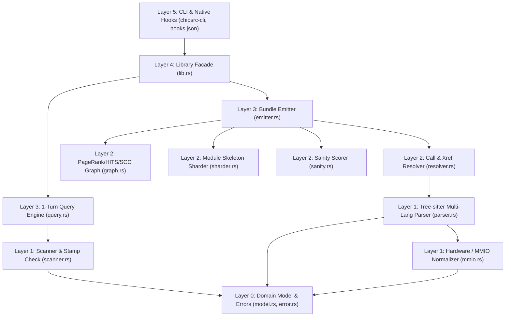

# `chipsrc` — Architecture, Verification, and Roadmap (1.1.0)

## 1. Executive Summary & Core Design Philosophy

`chipsrc` is a **100% deterministic, zero-LLM code intelligence engine, CLI, and Hybrid Claude Code plugin** written in Rust. It converts firmware and software source repositories (`C`, `C++`, `Rust`, `Python`, `TypeScript`, `TSX`, `JavaScript`, `JSX`, plus `.astro`, `.vue`, and `.svelte` single-file components) into queryable **Hierarchical Agent Codebase Bundles** (`INDEX.md`, `sections/*.md`, `index/*.tsv`, `meta.json`, and incremental `cache/` AST shards).

**Version 1.1.0** is the production-hardening release: it fixes the four defects found by independent black-box QA, replaces the external QA script with an in-repo regression harness, makes incremental synchronization meet its budgets at 12k-file scale, adds structural call-noise pruning and deterministic BM25 concept search, and adds real C++ coverage (content-detected headers, class templates, namespaces, out-of-line methods). `README.md` documents the user-facing behavior; this document records the architecture, the verification evidence, and what remains.

### Can `chipsrc` Function Independently Without an LLM?
**Yes — and it should remain 100% independent of any local or remote LLM in its core pipeline.**

1. **The caller is already a frontier LLM**: `chipsrc` is built for AI coding agents (Claude Code, Factory Droid, Cursor). Placing a small local model inside `chipsrc` creates a slow, redundant "LLM summarizing for an LLM" bottleneck where the smaller model has lower accuracy than deterministic AST extraction.
2. **Latency and resource constraints**: measured on this machine, a 1,221-file C++ corpus (`etl`) converts cold in ~9.4 s and a 12,471-file vendor SDK tree (`STM32CubeF4`, 4.55M lines) in a median 24.3 s; warm checks take a median 174 ms and indexed queries answer in ~45 ms with `--no-sync`. Adding even a small local model or embedding runtime would add hundreds of milliseconds to seconds per invocation plus a model's RAM footprint.
3. **Deterministic caching and CI verification**: every bundle is keyed by a deterministic BLAKE3 Merkle fingerprint. Identical source trees always produce byte-identical TSV indexes, Markdown skeletons, and graph rankings; two independent cold `STM32CubeF4` builds matched on all 1,508 artifacts (`index/`, `sections/`, `INDEX.md`).
4. **Empirical proof from QA**: the in-repo harness (`qa/`) replays the 123 legacy black-box assertions plus the new sync/perf/concurrency/scale/concept/C++/corpus/SFC suites against the release binary. All 16 assertions that failed on 1.0.0 now pass, and the full gate runs green with zero failures and zero skips.

---

## 2. How `chipsrc` Functions (End-to-End Architecture)

`chipsrc` enforces a strict unidirectional **Layered DAG (`Layer 0` $\to$ `Layer 5`)** with zero circular dependencies. `crates/chipsrc-core/tests/architecture_dag.rs` asserts that the core crate contains **exactly twelve modules** and that no module imports a higher layer.

### Layer-by-Layer Responsibilities

| Layer | Module(s) | How It Works |
| :--- | :--- | :--- |
| **Layer 0: Domain Model** | `model.rs`, `error.rs` | Canonical data structures (`ScannedFile`, `FileStamp`, `ExtractedSymbol`, `ExtractedType`, `ExtractedMacro`, `ParsedFileUnit`, `ResolvedCallEdge`, `XrefEntry`, `SectionShard`, `RepoMetadata`, `SanityReport`, `CacheManifest`), `CACHE_SCHEMA_VERSION` (`2.1.0`), and typed errors (`ChipsrcError`, including `IncompleteBundle` and `BundleLocked`). |
| **Layer 1: Ingestion, MMIO & AST Parsing** | `scanner.rs`, `parser.rs`, `mmio.rs` | **Scanner**: parallel `.gitignore`-aware walker (`ignore` + `rayon`), `FirstParty` / `VendorSdk` / `Test` scope classification, architectural layer detection, BLAKE3 Merkle fingerprinting, stat-only `stamp_check` on `(size, mtime_secs, mtime_nanos)`, unified `count_source_lines`, bundle artifact-integrity checks, and content-based `.h` C/C++ detection. **Parser**: multi-language Tree-sitter dispatcher (`C`, `C++`, `Rust`, `Python`, `TS`, `TSX`, `JS`, `JSX`) with byte-aligned TSX projection for `.astro`/`.vue`/`.svelte`, CMSIS qualifier handling, and C++ class templates, namespaces, nested classes, out-of-line `Class::method`, operator overloads, and long-template signature collapsing. **MMIO**: normalizes hex register literals (`0x400` $\leftrightarrow$ `400h`), extracts peripheral accesses (`GPIOA->MODER`, `*(volatile uint32_t *)`), and detects linker sections (`.intvecs`, `.ccmram`). |
| **Layer 2: Resolution, Graph, Sharding & Sanity** | `resolver.rs`, `graph.rs`, `sharder.rs`, `sanity.rs` | **Resolver**: links `caller -> callee` edges across five confidence tiers (`same_file`, `import_resolved`, `unique_global`, `ambiguous_name`, `external_or_macro`), drops structural call noise (unresolved qualified calls to names defined nowhere, unresolved bare Rust `PascalCase` constructors), builds the Unified Code + Hardware Cross-Reference Graph (`index/xref.tsv`), and computes active vendor SDK surfaces (`--vendor-mode active\|all\|none`). **Graph**: 25-iteration deterministic PageRank + HITS, iterative Tarjan SCC cycle detection, entrypoint/ISR detection, and upward layer-violation detection. **Sharder**: groups files by module into compact Markdown signature skeletons (`sections/*.md`) that keep docstrings, type fields, and signatures with exact `file:start_line-end_line` coordinates, auto-splitting oversized modules. **Sanity**: computes token compression ratio, clean parse ratio, call resolution ratio, and a structural sanity score (`0–100`). |
| **Layer 3: Bundle Emission & 1-Turn Query Engine** | `emitter.rs`, `query.rs` | **Emitter**: writes `INDEX.md`, `sections/*.md`, `index/*.tsv`, `meta.json`, `cache/manifest.json`, per-file shards or 256-unit packs, `cache/graph_state.json`, optional `--single-file`, and `.claudeignore`. All writes go through `write_bytes_atomic`; writers hold the advisory `BundleLock` on `<out>/cache/.lock`. **Query Engine**: discovers bundles, runs the automatic freshness/self-heal gate (`auto_refresh_bundles`), and executes 1-turn queries (`sym`, `type`, `callers`, `callees`, `path`, `impact`, `macro`/`reg`/`mmio`, `section`, `xref`, `search`), including regex/literal search and deterministic BM25 concept search. |
| **Layer 4 & 5: Facade, CLI & Auto-Sync Hooks** | `lib.rs`, `crates/chipsrc-cli/src/main.rs`, `hooks/hooks.json` | Library entrypoints (`inspect_repo`, `convert_repo`, `ensure_repo`, `auto_refresh_bundles`, `workspace_status`) and the `chipsrc` binary, including native `chipsrc hook session-start` and `chipsrc hook post-edit` subcommands for automatic Claude Code synchronization. |

### Cache Layout

- `cache/manifest.json` (schema `2.1.0`) maps every relative path to its BLAKE3 content hash, structural digest, language, and shard.
- Per-file shards are keyed by `blake3(rel_path + "\0" + content_hash)`. They are **not** purely content-addressed: byte-identical files at different paths must never alias, because a shard carries path-dependent data.
- Repositories with more than 500 source files pack 256 units into deterministic `cache/pack-<16hex>.json` files (12,471 files -> 49 packs); smaller repositories keep one shard per file.
- `cache/graph_state.json` persists the linked-graph annotations (PageRank/HITS/degree/SCC, god nodes, entrypoints, layer edges, cycles, vendor surface) that cannot be re-derived from a single file's AST.

### How Incremental Synchronization Works

`convert`, `ensure`, query auto-refresh, and both hooks share one tier ladder:

1. **Tier 0 — Integrity gate**: `meta.json`, `INDEX.md`, all six `index/*.tsv` (with valid headers), every `sections/*.md` listed in `index/sections.tsv`, `cache/manifest.json`, and every referenced shard must exist. Anything missing is treated as stale and rebuilt, so incomplete bundles self-heal.
2. **Tier 1 — Stat-only hit**: the walk compares `(size_bytes, mtime_secs, mtime_nanos)` and never opens an unchanged file. `CACHE HIT` costs 5–11 ms on a 123-file repository and a median 174 ms on `STM32CubeF4` (12,471 files).
3. **Tier 2 — Digest no-op**: the dirty file is re-parsed and its `structural_digest` is compared. When the digest **and** the line coordinates are unchanged, only that file's cache shard and `meta.json` are rewritten (< 25 ms budget).
4. **Tier 3 — Coordinate shift**: the digest is unchanged but line numbers or docstrings moved, and no C/C++ file, sharder threshold, or scope/layer change is involved. `resolve_and_link` and `analyze_graph` are skipped (`link=0ms graph=0ms`), the persisted graph metrics are re-attached 1:1, and only shard + emit run. Output is byte-identical to `convert --force`.
5. **Tier 4 — Structural**: full re-link, graph analysis, shard, and emit. On a 123-file repository this is a median 85 ms total with a 27 ms `emit` stage.

Concurrency: every write is temp-file + rename, and writers hold `cache/.lock` (create-new, 10 s stale window, heartbeat, owner-token deletion). Background callers (query auto-refresh, `hook post-edit`) wait at most **150 ms** and then skip the refresh and serve the on-disk bundle; explicit `convert`/`ensure` wait at most **5 s** and then fail with `BundleLocked`.

### Concept Search

`search --kind concept "<words>"` ranks rows of `index/symbols.tsv`, `index/types.tsv`, and `index/macros.tsv` with BM25 (`k1=1.2`, `b=0.75`) over camelCase / snake_case / acronym sub-tokens, weighting name x3, docstring x2, and signature/fields/value plus file stem x1, multiplied by `(matched_terms / |Q|)^2`, with pagerank/id tie-breaks. It is computed per query (no persisted index, no new dependencies) and takes ~16 ms on the `chipsrc` bundle. Multi-token `search` queries with zero literal/regex hits fall back to the same ranking automatically; `--source` / `--kind source` disable the fallback, and nonsense queries still return `[]`.

### C++ Coverage

`.h` headers are content-classified: a one-pass byte scan for C++ constructs (`class `, `template<`, `namespace `, `::`, `public:`/`private:`, `typename`, `nullptr`, `constexpr`, `virtual`, `operator`) skips comments, string/character literals, and raw strings, and selects the C++ grammar only when a marker appears in code. The detected language is stored on the scanned file and in `meta.json`, so `inspect` reports `cpp`. Class/struct templates drop their argument lists from names, types and symbols are namespace-qualified, out-of-line `ReturnT Class::method` definitions get `enclosing_type`/`qualified_name` and exact coordinates, and parameter lists longer than 80 characters collapse to `template<...>`. On `etl` this raises `parse_clean_ratio` to ~0.91 and makes `type ivector`, out-of-line method `sym`, and template-class `callers`/`callees` work.

---

## 3. Verification & Benchmarks (Delivered in 1.1.0)

### 3.1 Agent Efficiency Benchmark (1.0.0 design evaluation)

Measured across 6 representative coding-agent tasks (point symbol lookup with body, struct layout inspection, direct callers, multi-hop call path, 5-hop blast radius, and module API skeleton reading). Task shapes and output formats are unchanged in 1.1.0:

| Metric | `chipsrc` | `ripgrep` + `Read` | Improvement |
| :--- | ---: | ---: | :--- |
| **Total LLM Turns (Tasks T1–T5)** | **5 turns** (1 turn per task) | **14–16 turns** | **9–11 fewer LLM round-trips (~25–45 s saved)** |
| **Cumulative Context Tokens (T1–T5)** | **2,852 tokens** | **19,334 tokens** | **6.8x token reduction** |
| **Multi-Hop Call Path (`path`)** | **229 tokens** (1 turn) | **3,418 tokens** (4 turns) | **14.9x token reduction** |
| **5-Hop Blast Radius (`impact`)** | **800 tokens** (1 turn) | **10,844 tokens** (5–6 turns) | **13.6x token reduction** |
| **Full Bundle Compression (`chipsrc` repo)** | **28,250 bundle tokens** | **158,265 raw source tokens** | **5.6x compression** |

### 3.2 Rust & Python Test Suites

- `cargo test --workspace`: **154 tests** (120 unit, 1 architecture-DAG, 13 integration, 20 invariants) covering parsing, resolution tiers, graph analysis, sub-sharding, vendor filtering, MMIO normalization, query scoring, artifact integrity, line counting, duplicate-content shards, atomic writes/locks, concept scoring, and C++ extraction.
- `cargo clippy --workspace --all-targets -- -D warnings` and `cargo fmt --all -- --check` are clean.
- `python -B -m unittest discover -s qa/tests`: **17 stdlib tests** for the harness's lock guard, binary marker, and summary labeling.

### 3.3 In-Repo Black-Box QA Harness (`qa/`)

The external `qa_blackbox.py` from the 1.0.0 audit was ported into the repository as a parameterized, stdlib-only package (`qa/qa_blackbox.py`, `qa/suites/*.py`, `qa/oracles/*.json`, `qa/fixtures/`, `qa/lib/`). It runs against the release binary and real corpora, records one JSON record per assertion with `args`/`exit`/`wall_ms`, and skips (never fails) missing repositories.

| Gate | Assertions | Records | Result |
| :--- | ---: | ---: | :--- |
| `--suite core` (`real`, `sync`, `boundary`, `focused`, `hooks`, `dup-content`) | 130 | 283 | 0 failed, 0 skipped |
| `--suite core --suite concept --suite cpp` | 151 | 345 | 0 failed, 0 skipped |
| `--suite core --suite concept --suite scale --suite cpp` | 163 | 377 | 0 failed, 0 skipped |
| `--suite corpus --suite sfc` | 66 | 123 | 0 failed, 0 skipped (ten-repository matrix) |

Key outcomes:

- All **123 legacy assertions** from the 1.0.0 audit are preserved and green, including the 16 that previously failed (`Same-second edit must be stale`, `Query repairs missing symbols table`, `{python,typescript,c}: syncs same-second symbol`, `Incremental and forced source line counts agree`, `Post-edit refreshes equal-size same-second edit`, …).
- The ten-repository `corpus` matrix (`chipsrc`, `chipdoc`, `smart_locker`, `volt_website`, `beautiful-embedded-c`, `stock_screener`, `my-sunshine`, `chiparch`, `STM32CubeF4`, `etl`) verifies inspect/convert count agreement, warm cache hits with unchanged artifacts, `--force` byte identity, symbol-coordinate validity, and sanity bounds.
- `perf` and `concurrency` verify the sync budgets and the lock contract; `scale` and `cpp` verify the large-corpus budgets and C++ extraction; `concept` verifies ranking, fallback, determinism, and latency; `sfc` verifies JSX/Vue/Svelte mutation and coordinate mapping.

### 3.4 Measured Performance (this machine)

12 logical cores, 15.9 GB RAM, Windows/NTFS with a rotational `D:` volume; medians of three runs where noted.

| Scenario | Corpus / scale | Measured | Budget |
| :--- | :--- | ---: | ---: |
| 1-file structural edit (`emit` / `total`) | `smart_locker`, 123 files | 27 ms / 85 ms | < 50 / < 100 ms |
| Coordinate-shift sync (`link`+`graph` skipped) | `smart_locker`, 123 files | 132–151 ms total | link/graph skipped |
| Warm `CACHE HIT` | `smart_locker`, 123 files | 5–11 ms | — |
| Warm `CACHE HIT` | `STM32CubeF4`, 12,471 files | 174 ms (`scan`/`total`) | < 300 ms |
| Cold `convert --force --vendor-mode all` | `STM32CubeF4`, 12,471 files / 4.55M lines | 24.3 s total (`link` 3.1 s, `emit` 8.1 s), peak RSS 1.47 GiB | < 40 s, link ≤ 14.35 s, emit ≤ 16.45 s, RSS < 1.5 GiB |
| Auto-sync query | `STM32CubeF4` | `type` 174 ms · `sym` 208 ms · `reg` 258 ms | < 500 ms |
| `--no-sync` query | `STM32CubeF4` | ~45 ms | — |
| Cold link | `etl`, 1,221 files / 253k call edges | 0.6–1.4 s | ≤ 17.5 s |
| Concept search compute | `chipsrc` bundle | ~16 ms | < 30 ms |

Cold `STM32CubeF4` totals ranged 17.3–25.7 s across sessions: the drive's write latency dominates the `emit` stage, and the per-stage gates (link, emit, RSS) are the stable acceptance criteria. Budgets live in `qa/oracles/perf.json`; `qa/suites/scale.py` warms the corpus page cache before timing and records that warm-up as observational evidence.

---

## 4. Delivered Fixes & Known Limitations

### 4.1 Delivered in 1.1.0

| Item | Delivered behavior |
| :--- | :--- |
| **P0.1 Sub-second freshness** | `mtime_nanos` on `FileStamp`/`ScannedFile`; `stamp_check` compares `(size, mtime_secs, mtime_nanos)`, so same-size edits within the same second are caught by `status --check` (exit 2), `convert`, `ensure`, hooks, and auto-refresh. |
| **P0.2 Bundle artifact integrity** | `bundle_artifacts_complete` verifies `meta.json`, `INDEX.md`, all six `index/*.tsv` headers, every referenced `sections/*.md`, `cache/manifest.json`, and every shard; wired into `convert_repo`, `auto_refresh_bundles`, `workspace_status`, and both hooks. `--no-sync` queries on incomplete bundles exit non-zero naming the missing table. |
| **P0.3 Unified line counting** | One `count_source_lines` (`\n` count plus 1 for a non-empty unterminated last line) used by full scan and incremental paths; incremental and `--force` artifacts are byte-identical. |
| **P0.4 Duplicate-content aliasing** | Shards keyed by `blake3(rel_path + "\0" + content_hash)`; editing one of two byte-identical files preserves the sibling's section, symbols, and types. |
| **Cache schema 2.1.0** | Old `2.0.0` manifests and stamps without `mtime_nanos` rebuild once and then hit cache. |
| **P1.1 `emit_bundle` optimization** | `Cow`-based `sanitize_tsv`, pre-sized/`push_*` rows, single `read_dir`, previous-manifest digest reuse, uncapped content-compare write skip, single `meta.json` write, packed cache shards; 1-file edit emit 265 ms -> 27 ms, total 477 ms -> 85 ms. |
| **P1.2 Coordinate-shift tier** | Tier 3 skips `resolve_and_link`/`analyze_graph` via `cache/graph_state.json`; output byte-identical to `--force`; threshold fallback covered by tests. |
| **P2.2 Atomic writes & lock** | `write_bytes_atomic` for every bundle write and the advisory `cache/.lock` (150 ms background / 5 s explicit budgets, heartbeat, owner-token release, stale reclamation). |
| **Scale warm path** | Parallel stat-only `stamp_check` and single-parse bundle gates: 12k-file warm check 2.24 s -> 174 ms; auto-sync query 2.3 s -> ~200-260 ms. |
| **Scale cold path** | Header-prototype merge and vendor-surface matching rewritten, parallel table rendering, streamed `index/*.tsv`, packed cache shards, serial section stream; `STM32CubeF4` cold 65-76 s -> 24.3 s median, `link` 20.8 s -> 3.1 s, `emit` 33.2 s -> 8.1 s, peak RSS ~1.47 GiB. `etl` link 35 s -> 0.6-1.4 s. |
| **P2.1 Call-noise pruning** | Two structural rules drop unresolved qualified calls to names defined nowhere and unresolved bare Rust `PascalCase` constructors; resolved edges unchanged, `call_resolution_ratio` rises (e.g. `chipsrc` 0.528 -> 0.693). |
| **P2.3 BM25 concept search** | `search --kind concept` plus automatic multi-token fallback; deterministic, ~16 ms, no persisted index, nonsense queries return `[]`. |
| **C++ coverage** | Content-based `.h` detection, class/struct templates, namespaces, nested classes, out-of-line methods, operators, ctors/dtors, `using` aliases, template-list collapsing; `etl` clean parse 0.73 -> ~0.91. |
| **In-repo QA harness** | `qa/` with 14 suites, externalized oracles, checked-in fixtures, skip-if-missing preflight, large-convert guard, and per-binary bundle markers; green gates listed in §3.3. |

### 4.2 Known Limitations & Intended Behavior

- **Cold emit on slow/contended volumes**: the `STM32CubeF4` bundle writes 1,705 artifacts (49 cache packs, 1,501 section shards, six large TSVs including a 239 MB `xref.tsv`). On a busy rotational drive `emit` and `total` can exceed their budgets while every deterministic assertion still passes. Re-run the `scale` suite on a quiet volume before treating a timing miss as a regression; do not raise the budgets.
- **ETL clean-parse headroom**: `parse_clean_ratio` is ~0.91 against a 0.90 floor. The remaining parse errors are statement-position macros in test files (`test_intrusive_list`, `test_make_string`, `test_multi_span`, `test_type_def`, `test_type_traits`, …) that the Tree-sitter C++ grammar cannot parse; they are documented, not repaired by macro rewriting.
- **STM32CubeF4 MMIO literals**: the corpus has no absolute register literals, so `reg 0x40020000` correctly returns `[]`; use symbolic queries (`reg GPIO_MODER`). `GPIOA_BASE` records `hex_addr=0x0`.
- **Header guards**: header-guard macros (e.g. `MOTOR_CTRL_H`) are not indexed as register macros; this is intended.
- **`ensure` output naming**: `ensure <repo> -o <root>` creates `<root>/<repo-stem>`; the bundle name is not user-chosen.
- **Concept search is recomputed per query**: this is a design choice (no persisted index, no new dependencies). It stays under 30 ms on 2-3k-symbol bundles; a 59k-symbol bundle is not the intended target for broad concept queries.
- **Corpus list**: the ten-repository QA matrix uses `chiparch`. The `work` checkout referenced during mission planning no longer exists on disk; `qa/oracles/corpus.json` and `qa/README.md` were updated accordingly.

---

## 5. Roadmap / Candidate Future Work

1.1.0 closes the P0-P2 roadmap from the 1.0.0 audit. Remaining candidates, none of which block the release:

| Area | Candidate | Notes |
| :--- | :--- | :--- |
| Cold I/O | Further reduce artifact count (larger packs, fewer section shards, or a single cache database) | The `emit` stage is bounded by small-file creation on rotational disks; any change must preserve the path-keyed shard contract. |
| Query latency | Offset index for very large `macros.tsv` / `xref.tsv` tables | The macro prefilter already brings a 492k-row table query to ~140 ms (`--no-sync`); an offset index would help a 100 MB+ table further. |
| Parsing | Remaining statement-position macro repairs for C++ test frameworks | Grammar-level limitation; today's ratio is documented in §4.2. |
| Platform CI | Linux/macOS validation of the lock contract | NTFS-specific handle semantics are `#[cfg(windows)]`-tested; a Unix CI job should run the portable lock tests. |
| Coverage | More language grammars (Go, Java, C#) | Would require new dependencies; deliberately out of scope for 1.1.0. |
| Semantics | Local embeddings / LLM reranking | Explicitly rejected by the design principles in §1; BM25 concept search covers deterministic retrieval. |
